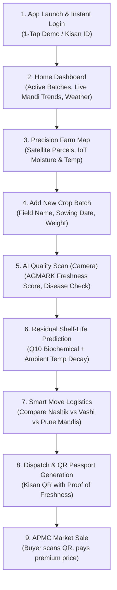

# 🌾 Annapurna FreshGuard — Product Requirements Document (PRD)

---

## 1. Executive Summary & Vision

**Annapurna FreshGuard** is an end-to-end, AI-powered Agri-Tech & Post-Harvest Logistics Intelligence platform engineered specifically for Indian farmers. The platform bridges the gap between field-level crop management and regional market arbitrage, preventing post-harvest losses and eliminating distress selling.

By combining **ISRO/ArcGIS Satellite Spectral Remote Sensing**, **IoT Soil/Canopy Sensors**, **Computer Vision Quality Grading (AGMARK)**, **Biochemical Shelf-Life Modeling (Q10/Arrhenius)**, and **Real-Time APMC Mandi Arbitrage**, Annapurna empowers farmers to maximize crop yield, verify quality, and sell at the highest possible profit.

---

## 2. Farmer Persona & Problem Statement

### Primary Persona: *Kisan Ramesh Patel (Nashik / Maharashtra)*
- **Land Holding**: 12.5 Hectares (Tomato, Red Onion, Wheat, Soybeans).
- **Pain Points**:
  1. **Distress Selling**: Selling tomatoes locally for ₹2,200/qtl while Vashi Mumbai APMC pays ₹3,400/qtl due to fear of in-transit spoilage.
  2. **Lack of Objective Quality Proof**: Middlemen offering lower prices citing inferior grade without scientific verification.
  3. **Fragmented Data**: Weather, mandi rates, crop health, and logistics information are scattered across multiple incompatible platforms.
  4. **Language & Usability Barrier**: Complex text-heavy apps with CAPTCHA locks and unintuitive navigation.

---

## 3. End-to-End Farmer User Workflow

---

### Detailed Step-by-Step Farmer Journey:

#### **Step 1: Onboarding & Authentication**
- Farmer opens the app on their smartphone or web browser.
- Enters their Username/Password or taps **"1-Tap Demo / Guest Login"** for instant access without CAPTCHAs.
- The app initializes the farmer's profile, saved coordinates, and offline cache.

#### **Step 2: Home Command Center Overview**
- Farmer checks the **Executive Summary**:
  - Live local weather (temperature, humidity, rain alert).
  - Quick action toolbar: *Add Batch*, *AI Scan*, *Mandi Rates*, *Smart Move*.
  - Floating **Annapurna Vaani Voice Assistant** button available in their native language (Telugu, Hindi, Marathi, English).

#### **Step 3: Precision Farm Management & Satellite Parcels**
- Farmer views their land parcels via **High-Resolution Satellite Imagery** (ArcGIS World Imagery).
- Observes field health:
  - **NDVI Canopy Index** and **Thermal Stress Hotspots** (identifying water stress in southern quadrants).
  - Telemetry metrics: Soil Moisture (`42 kPa`), Water Supply, Ambient Temp (`32°C`), and Soil pH (`5.8`).
  - Checks off daily operations (e.g., *Irrigation - North Field*, *Pesticide Application*).

#### **Step 4: Creating / Managing a Harvest Batch**
- When harvesting a field (e.g., *Tomato Roma - 500 kg*), farmer navigates to **"Manage Crop Batches"**.
- Taps **"+ Add New Batch"** and fills basic crop info (or imports coordinates directly from their registered field).

#### **Step 5: AI Agro-Vision Quality Scan**
- Farmer points their camera at the harvested tomatoes or uploads a photo.
- **AI Vision Pipeline** analyzes the produce and generates:
  - **AGMARK Quality Score** (e.g., `82/100`).
  - **Ripeness Stage** (*Optimal / Turning Pink*).
  - **Pathogen Detection** (*0% Surface Rot / No Fungal Blight*).

#### **Step 6: Real-Time Shelf-Life Calculation**
- The **Biochemical Respiration Engine** computes:
  - Base shelf-life at standard storage (`9.0 Days`).
  - Temperature decay factor during road transit (using OpenWeather live ambient degree-hours).
  - Ethylene cross-contamination risks if transported with onions or bananas.

#### **Step 7: Smart Move — Mandi Arbitrage & Route Optimization**
- The app compares regional APMC markets:
  - **Local Mandi (Nashik)**: ₹2,400/qtl • Distance: 15 km • Transit time: 45 min • Net profit: ₹12,000.
  - **Terminal Market (Vashi Mumbai)**: ₹3,400/qtl (+40% Premium) • Distance: 168 km • Freight: ₹1,000 • In-transit loss: 0.8 days • **Net profit: ₹15,800 (+₹3,800 profit)**.
- Recommends the optimal market with guaranteed shelf-life security upon arrival.

#### **Step 8: Traceable QR Code Generation & Market Sale**
- Farmer generates a tamper-evident **Kisan QR Passport** containing:
  - Batch ID, Harvest Date, AGMARK Freshness Grade, and Geolocation.
- Farmer prints or presents the QR code at the APMC mandi auction.
- Wholesale buyers scan the QR code to verify freshness, enabling the farmer to demand top-tier pricing.

---

## 4. Complete Feature Specifications

| # | Feature Module | Technical Components | Farmer Value / Outcome |
|---|---|---|---|
| **1** | **Seamless Authentication & Profile** | JWT Tokens, Persistent AsyncStorage, Kisan ID, Editable Acreage | Zero friction login, no CAPTCHA barriers, portable farmer credentials. |
| **2** | **Precision Satellite & Field Grid** | Leaflet.js, ArcGIS World Imagery, PostGIS Polygon AOI, IoT Telemetry Badges | Pinpoint soil moisture deficiencies and thermal crop stress before visual damage occurs. |
| **3** | **AI Vision Quality Grading** | Google Gemini 2.5 Flash Vision, Structured AGMARK AG-Standard JSON | Instant scientific grading of ripeness and pathogen risks without costly laboratory testing. |
| **4** | **Biochemical Shelf-Life Engine** | $Q_{10}$ Respiration Formula, Arrhenius Temperature Degradation | Calculates exact days until spoilage based on real-time transit temperatures. |
| **5** | **Live APMC Mandi Radar** | National Mandi Price Feeds, Leaflet Map with Filter Chips, Distance Radii | Live comparison of prices across nearby and high-demand metro terminal mandis. |
| **6** | **Smart Move Logistics Optimizer** | Multi-Factor Arbitrage Scoring, Freight Cost vs. Price Premium Calculator | Tells farmers precisely which mandi yields the highest net profit after transport costs. |
| **7** | **Annapurna Vaani Voice Assistant** | Inworld AI Agent + Gemini Fallback, Telugu, Hindi, Marathi, English | Allows farmers to ask questions via voice while working in the field. |
| **8** | **Digital Batch Passport & QR Scanner** | `react-native-qrcode-svg`, QR Scanner, Cryptographic Batch ID Verification | Creates verifiable proof of harvest quality, building buyer trust and premium auction rates. |
| **9** | **FPO Shared Freight & B2B Buyer Hub** | Micro-pooling coordinator, Direct gate contracts (Kissan, Reliance), Solar Cold Rooms | Drops smallholder freight by 78% (₹850/farmer), guarantees floor price contracts, prevents distress dumping. |

---

## 5. System Architecture & Tech Stack

### Mobile Frontend
- **Framework**: React Native with Expo SDK 52 (Web & Mobile cross-platform).
- **Styling**: Modern Glassmorphic Design System, Custom Tokens, CSS/StyleSheet.
- **Cartography**: Leaflet.js integrated through `react-native-webview` with responsive web fallback.
- **Animations**: Custom Spring & Fade-in Motion Tokens with Reduced Motion accessibility.

### Backend Services
- **API Framework**: FastAPI (Python 3.11/3.14) with Uvicorn ASGI server.
- **Data Layer**: PostgreSQL 16 + PostGIS + TimescaleDB (Aiven Cloud) + Redis Cache (Upstash).
- **AI & Vision**: Google Gemini 2.5 Flash Vision API (`gemini-2.5-flash`) & Inworld AI.
- **Geospatial & Weather**: OpenWeatherMap API, ISRO Bhoonidhi / Sentinel-2 Spectral Pipeline.

---

## 6. Non-Functional Requirements & Resilience

1. **Offline-First Graceful Fallbacks**:
   - In low-connectivity rural zones, the app automatically switches to cached batches, historical APMC price models, and local rule-based shelf-life formulas.
2. **Sub-Second Response Times**:
   - Core endpoints (batches, dashboard, mandi prices) respond within **< 120ms** via Redis caching.
3. **Multilingual Inclusivity**:
   - Native support for Indian regional languages: Telugu, Hindi, Marathi, Tamil, Kannada, and English.
4. **Data Privacy & Security**:
   - Encrypted JWT bearer authorization, verified Kisan credentials, and secure QR token hashing.
